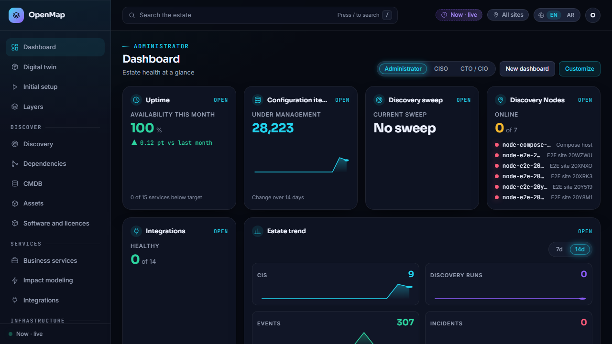
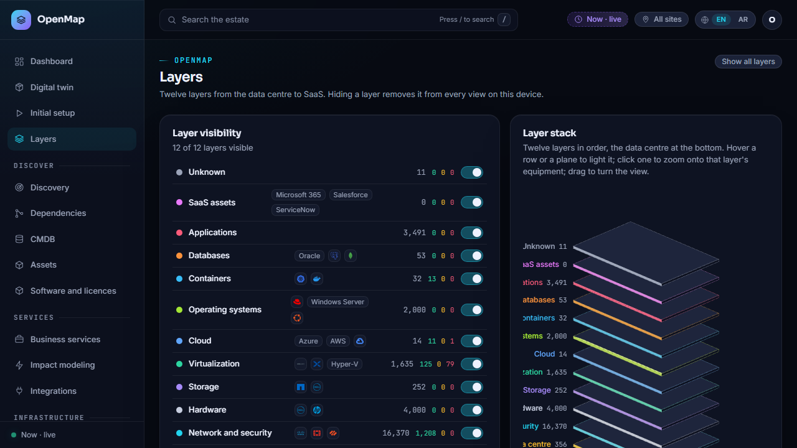
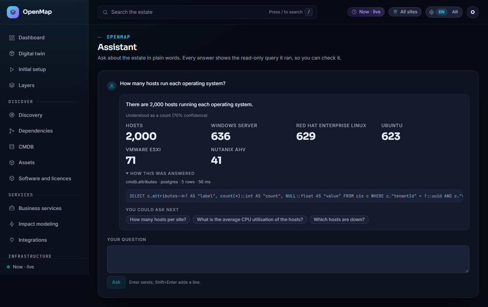
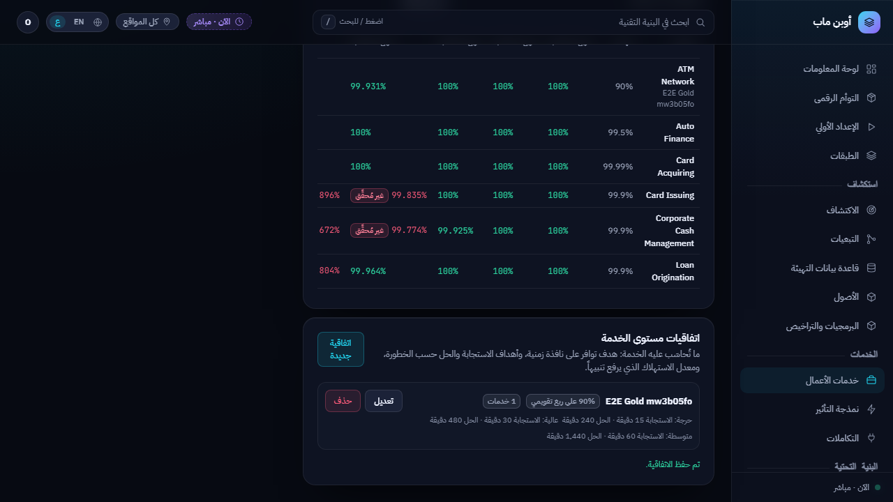

# OpenMap

**A sovereign, open-source-based IT estate platform: discovery, CMDB, dependency mapping, IPAM/DNS/DHCP, DCIM, assets and licences, vulnerability correlation, business service management, time travel, embedded analytics and a grounded AI assistant, in one product, in English and Arabic.**

OpenMap is built as a complete replacement for Device42. It runs on open-source components only, makes no outbound call at runtime except collectors talking to their targets, passes its full test suite in an air-gapped profile, and is designed around one twelve-layer model of the estate so every screen, query and answer agrees on what a thing is and what depends on it.

<p align="center">
  
  
</p>
<p align="center">
  
  
</p>

> Status: under active development. 107 of 206 tracked requirements are Done (see [docs/TRACKER-SUMMARY.md](docs/TRACKER-SUMMARY.md) and [docs/STATE.md](docs/STATE.md)). Every Done requirement has tests and evidence in the tracker; nothing is a stub or a demo page.

## What it does

| Area | What is built |
| --- | --- |
| **Discovery** | Agentless collectors run by Discovery Nodes per site over mTLS: SNMP, SSH/Linux, WinRM/Windows, Redfish, VMware, Hyper-V, Nutanix, libvirt, oVirt, Kubernetes, NetApp, Pure, F5, Citrix ADC, A10, HAProxy, NGINX, NetFlow, DHCP, DNS zones, directories, databases, certificates, object storage, NAS, FC fabrics, port scans, host agents, AWS, Azure, GCP, OCI, Alibaba, SaaS (Microsoft 365, Google Workspace, Salesforce, ServiceNow, Workday), vulnerability feeds, support contracts. Collectors emit observed CIs against a frozen JSON contract; the reconciler assigns identity, confidence and provenance. |
| **CMDB** | Bitemporal configuration items with identity keys, relationships, short codes, user labels for unknown devices, evidence per observation, and time travel (`asOf`) on every read. |
| **Dependency mapping** | Memgraph-backed graph of the estate, impact closure with predicted states, redundancy-aware business-service propagation, what-if scenarios by component and condition. |
| **Layers and digital twin** | The twelve-layer stack (data centre, network and security, hardware, storage, virtualisation, cloud, OS, containers, databases, applications, SaaS, unknown) rendered as an interactive three.js scene, plus a rack and room twin drawn from DCIM data. |
| **IPAM, DNS, DHCP** | Subnet trees per site and VRF, address utilisation, next free address, DNS zones and records, DHCP scopes and leases, discovery scopes. |
| **DCIM** | Sites, rooms, rows, racks, elevations, PDUs, power circuits, UPS, cooling, cabling, per-device power and headline metrics. |
| **Assets and licences** | An asset register for every owned CI with warranty, subscription (software, SaaS and cloud), support and end-of-life cover, data-gap filters, manual entry, infrastructure plans and bills of material, software products and licence positions. |
| **Business services** | Service health propagated by the BSM engine, SLA catalogue and assignment, error budgets, uptime by month, quarter and year from ClickHouse history, incidents with response targets, assignment, resolution and root-cause analysis. |
| **Security** | Vulnerability correlation to installed software and hosts, exploited and internet-facing filters, an immutable audit log through the outbox, SSO and roles from Keycloak, secrets in OpenBao. |
| **Analytics and dashboards** | Embedded Apache Superset dashboards per tenant, persona dashboards (administrator, CTO/CIO, operations, finance) built from a widget catalogue, estate trends. |
| **Assistant** | A conversation over the estate in English or Arabic: a deterministic bilingual classifier, retrieval skills over Postgres, Memgraph and ClickHouse (counts, attribute statistics, measurements, availability, incidents, impact, history, how-to, NL→Cypher), answers worded with their figures and evidence, a grounding guard on any model-written prose, follow-ups and clarifying questions. A checked-in evaluation set runs in CI with an accuracy floor. |
| **Integrations** | Outbound webhooks and ITSM, SIEM, SOAR, monitoring, identity and finance adapters as data, with delivery tracking; tenant-enabled, off by default. |
| **Onboarding** | A setup wizard that creates the organisation, business units, sites, inter-site links, Discovery Nodes with enrolment tokens, credential sets and discovery scopes, then generates the twin and starts the first sweep. |

Arabic and right-to-left layout are first-class: every user-facing string is an i18n key with both locales filled, and the build fails on a missing key.

## Architecture

| Concern | Component |
| --- | --- |
| Console | Next.js 15 (App Router), React 19, Tailwind, the Obsidian Pro design system in `packages/ui`, Sigma.js and three.js for graphs and twins |
| API | NestJS on Fastify, GraphQL (Mercurius) against a frozen schema in `packages/contracts`, REST and WebSocket |
| Reconciler, scheduler, BSM engine | TypeScript services; every cross-store write goes through a transactional outbox |
| Discovery Node and collectors | Go; mTLS enrolment, job pull, collector supervisor, host agents for Linux, Windows and macOS |
| Assistant | TypeScript package (`apps/assistant`) plus API skills; any OpenAI-compatible local model (vLLM on GPU, llama.cpp on CPU) |
| Stores | PostgreSQL (system of record, Prisma), Memgraph (dependency graph), ClickHouse (metrics, health history, audit), Valkey (queues), Meilisearch (search) |
| Platform | Keycloak (identity), OpenBao (secrets), Apache Superset (analytics), OpenTelemetry collector and Prometheus (observability) |

Contracts come first: the CI schema, the collector JSON schema, the GraphQL schema and the event schema are versioned in [docs/CONTRACTS.md](docs/CONTRACTS.md) and changing one requires an architecture decision record ([docs/adr](docs/adr)) and a CI check.

## Repository layout

```
apps/
  api/           NestJS: GraphQL, REST, WebSocket, the assistant skills
  console/       Next.js console (en, ar), Playwright e2e
  reconciler/    reconciliation and outbox fan-out to Postgres, Memgraph, ClickHouse, Meilisearch
  scheduler/     discovery planning, Node API (mTLS), job submission
  assistant/     classifier, planner, composer, grounding guard, evaluation set
  bsm-engine/    health propagation, SLA evaluation, incident correlation
  node/          Go Discovery Node runtime
  collectors/    Go collector families (one package per family)
packages/
  config/        zod-validated environment and tenant settings (the only place env is read)
  constants/     named constants with rationale
  contracts/     frozen contracts: zod schemas, emitted JSON Schema, GraphQL schema
  db/            Prisma schema and migrations, ClickHouse DDL, Memgraph schema
  graph/         Cypher repository (Memgraph; Neo4j adapter)
  i18n/          en and ar catalogues
  ui/            design tokens and components, RTL
  telemetry/     OpenTelemetry helpers
tools/
  tracker/       the requirements tracker CLI (ExcelJS)
  guard/         the build guard (forbidden tokens, literals, magic numbers, i18n, REQ headers)
  synth-estate/  deterministic synthetic estate generator (100k CIs) replayed through the real collector contract
  perf/          k6 and Lighthouse budgets
deploy/
  compose/       single-node, CPU/GPU LLM profiles, air-gapped overlay
  helm/          Kubernetes chart
  airgap-bundle/ offline image and migration bundle
  install/       Node and agent service installers (systemd, launchd, Windows)
docs/            CONTRACTS.md, STATE.md, CAPABILITY-MAP.md, COLLECTORS.md, adr/, evidence/
```

## Quick start

Requirements: Docker with Compose, Node.js 24, pnpm 10, Go 1.26 (only to build collectors locally).

```bash
pnpm install
```

```bash
cd deploy/compose && docker compose -f docker-compose.yml -f docker-compose.apps.yml --profile cpu up -d --build
```

This brings up Postgres, Memgraph, ClickHouse, Valkey, Meilisearch, Keycloak, OpenBao, Superset, the OpenTelemetry collector, Prometheus, a CPU llama.cpp model server, runs the migrations once, and starts the API, console, scheduler, reconciler and BSM engine. The console is on port 3000, the API on 4000, Keycloak on 8080 and Superset on 8088 by default; every port and URL is configuration in `packages/config`.

To see the product with data, generate and replay the synthetic estate (sites, racks, 5k network devices, 40k hosts, 30k VMs, Kubernetes, business services, IPAM, PDUs, metrics and health history) through the real collector contract:

```bash
pnpm --filter @openmap/synth-estate exec tsx src/cli.ts generate --out ./estate --scale 0.05
```

Then register a Discovery Node and submit a replay job as described in [deploy/README.md](deploy/README.md), which also covers the air-gapped bundle, the Kubernetes chart, SSO and MFA, API tokens, the GPU model profile and installing Nodes and host agents as services.

## Engineering practice

- **No hardcoding.** Hosts, ports, thresholds, limits, model names and feature switches come from validated configuration, tenant settings or named constants; the guard fails the build on literals and magic numbers in application code.
- **Everything tracked.** `tracker/OpenMap-Tracker.xlsx`, maintained only through `pnpm tracker`, holds every requirement with acceptance criteria, tests and evidence; `pnpm tracker verify` runs in CI and in the pre-commit hook and rejects a Done row without both.
- **Tests at every level.** Vitest unit tests, integration tests against the real compose stack, Playwright end-to-end tests in both locales, k6 budgets for endpoints and Lighthouse budgets for screens, Go tests with protocol-shaped stand-ins for vendor APIs (no fabricated fixtures).
- **Evidence.** Each shipped capability has a note under [docs/evidence](docs/evidence) with the measurements and screenshots it was accepted on.
- **Knowledge graph.** The code and documents are indexed with graphify (`graphify-out/`), committed as project memory and rebuilt on every commit.

Useful commands:

```bash
pnpm build && pnpm test && pnpm typecheck
```

```bash
pnpm guard && pnpm i18n:check && pnpm contracts:check
```

```bash
pnpm tracker status
```

## Documentation

- [docs/CAPABILITY-MAP.md](docs/CAPABILITY-MAP.md): the capability map against Device42, area by area.
- [docs/COLLECTORS.md](docs/COLLECTORS.md): collector families, protocols, credentials and what each observes.
- [docs/CONTRACTS.md](docs/CONTRACTS.md): the frozen contracts and their change log.
- [docs/adr](docs/adr): architecture decision records.
- [docs/STATE.md](docs/STATE.md): where the build is, what is next, open questions.
- [deploy/README.md](deploy/README.md): deployment profiles and operations.

## Licence

OpenMap is built on open-source components only; copyleft components run as separate processes and are never linked. A licence file for this repository has not been added yet.
